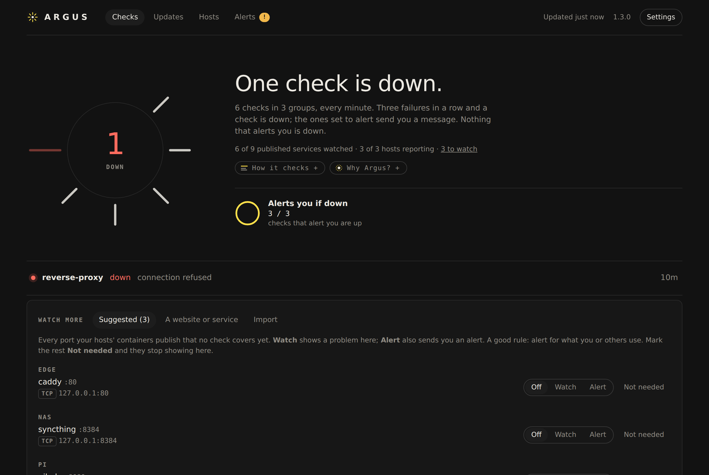
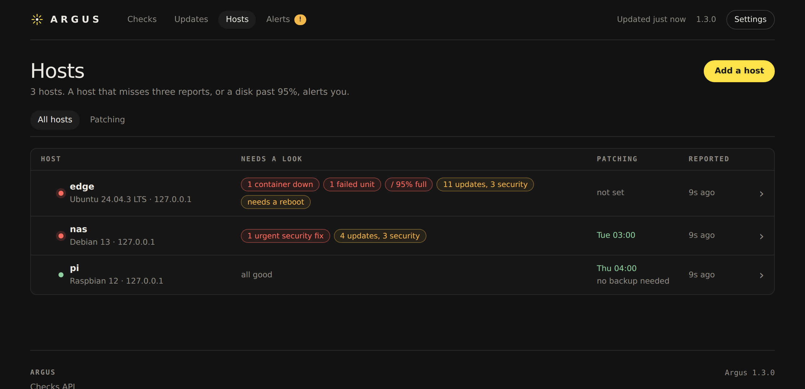
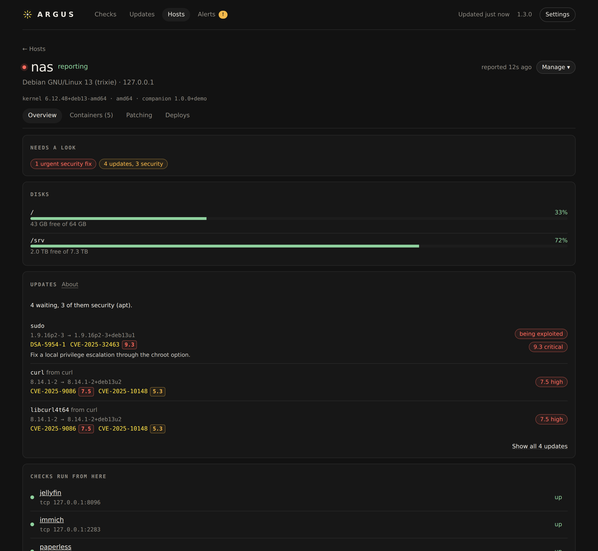
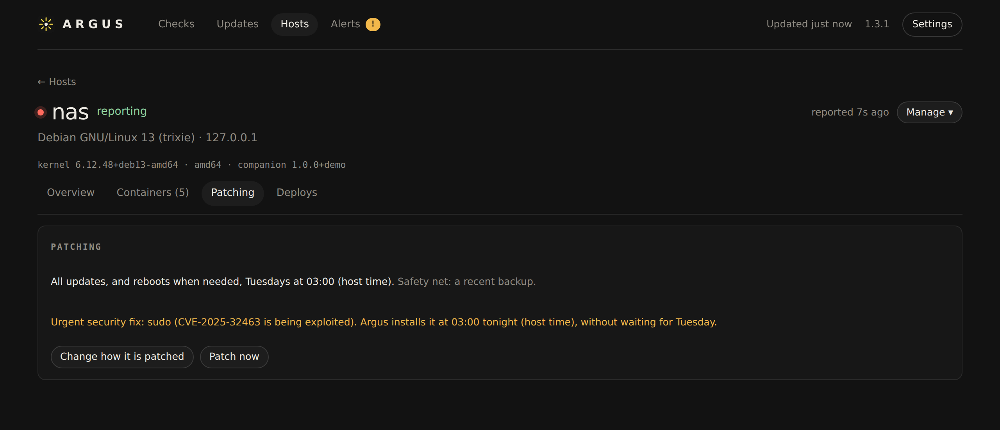
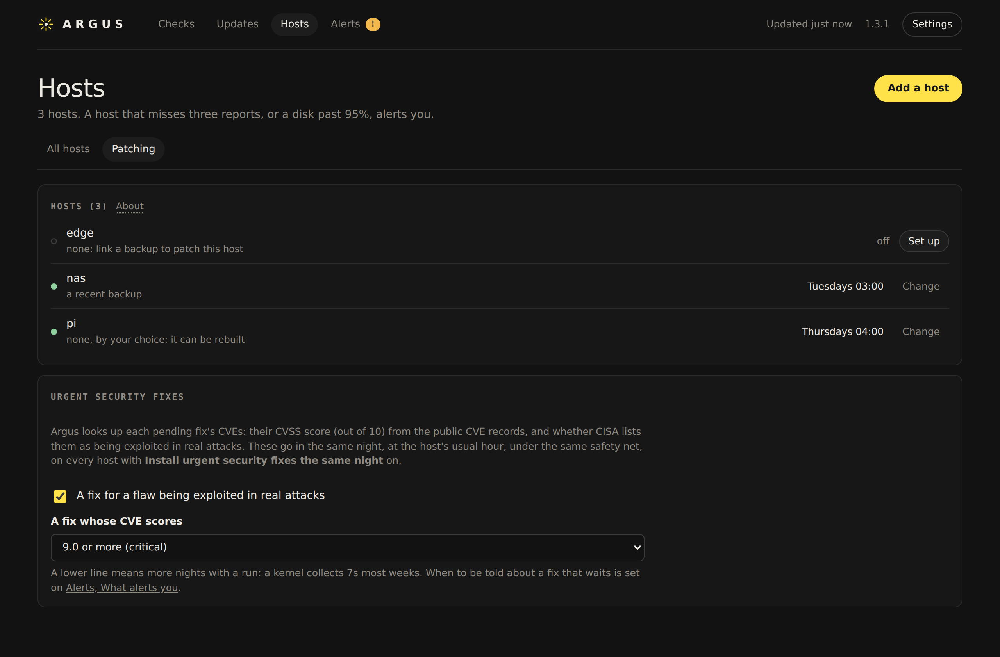
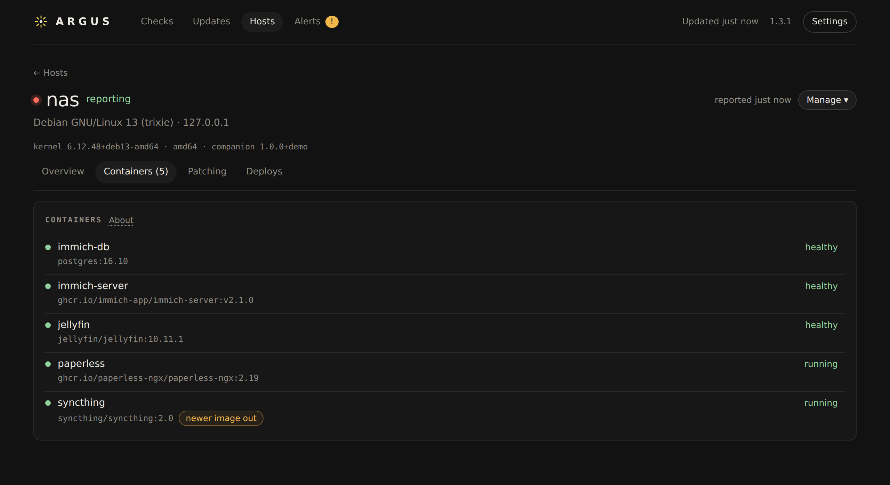
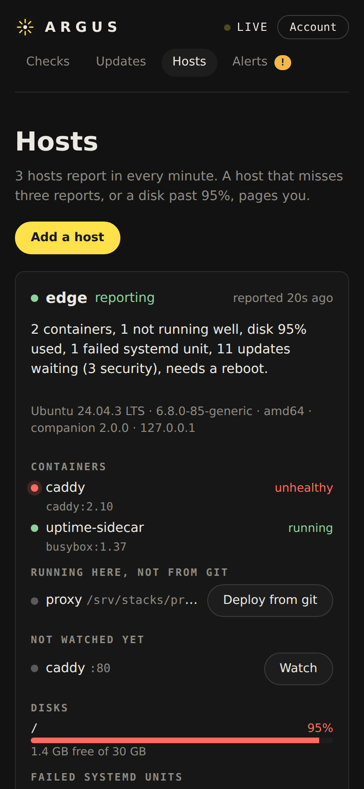

# Argus

**Keep a homelab watched, patched and deployed, from one container.**

Argus checks your services and alerts you when one stops answering. A small companion on each host shows its containers, disks and pending updates, patches it in a weekly window once it has a recent backup, and deploys your Compose stacks from git when you merge. No Prometheus, Grafana or Alertmanager needed, and no config files unless you want them.



## Why Argus

A homelab starts as a weekend project and ends up running things people rely on: the photo library, the password manager, the lights, the family's media. Every one of those apps, containers and servers needs security updates, all the time. Done by hand, that is hours of careful, repetitive work each week, so it slips. And a server that is weeks behind on updates is exactly what attackers look for: flaws are often used in real attacks within days of their fix coming out.

Turning on automatic updates is not the answer on its own. An update that breaks a machine with no way back is how people lose a weekend, or their data, and then turn updates off again.

Argus does the job the way a careful IT team would, without the team:

- **Nothing is patched without a way back.** A host is updated only when it has a recent backup or snapshot to return to, one host at a time, and a run that fails tells you. A stack deployed from git that does not come up healthy is rolled back on its own.
- **The dangerous fixes do not wait.** A fix for a flaw that is being exploited, or is rated critical, goes in that same night instead of at the next weekly window.
- **You hear about it only when you are needed.** Argus checks every service every minute and keeps the rest to its pages; your phone gets a message when something is down or a decision is yours.

It is named for the hundred-eyed giant of Greek myth, who never slept with all his eyes at once.

## What it does

- **Watches** anything with a URL, a port or an address, every minute, and alerts you on Telegram (or through your Prometheus).
- **Knows your hosts.** One command adds a host. Argus then shows its containers, disks, failed services and pending updates, with each CVE's severity score.
- **Patches** each host on the weekly schedule you choose, once it has a backup to return to. You decide how far updates go and whether it may reboot.
- **Deploys from git.** A merge to your stacks repo deploys it, and a stack that does not come up healthy is rolled back. Stacks already running move in with one button.
- **Follows your apps' updates** on GitHub, from a Dependabot pull request to running on its host.
- **Guides you in** with a short checklist, from nothing to your first host watched, patched and deploying.

## A look around

**Every host on one page**, with what needs a look on each and when it is patched. Each tag leads to its cause.



**One host:** its disks and pending updates. Every CVE an update fixes carries its severity score, and a fix for a flaw that is being exploited is marked.



**Urgent fixes do not wait for the weekly window.** The host's Patching tab says what goes in tonight and why.



**You set the rules:** a day and an hour per host, the backup it needs first, and how serious a flaw must be to go in the same night.



**Containers**, with a note when a registry serves a newer image under the tag one of them runs.



**On a phone** it is the same page, not a cut-down one.



## Quick start

```yaml
# compose.yml
services:
  argus:
    image: ghcr.io/devinmb/argus:1
    ports: ["8443:8080"]
    volumes: [argus-data:/data]
    cap_add: [NET_RAW]   # for ping checks
    restart: unless-stopped
volumes:
  argus-data:
```

```bash
docker compose up -d
docker compose logs argus | grep "Setup code"
```

Argus runs on amd64 or arm64 (a Raspberry Pi 4 or 5 is fine) with 1 core and 512 MB of memory; it uses about 150 MB with 18 hosts. See [install.md](docs/install.md) for the details.

Open **https://your-host:8443**. Argus makes its own certificate, so the browser warns once. Enter the setup code and choose a password, then follow the checklist. Want to look around first? [`scripts/demo.py`](scripts/demo.py) fills a fresh install with a made-up homelab.

## Learn more

- [Install](docs/install.md): requirements, the first sign-in, HTTPS and proxies, upgrading, removing Argus.
- [Guide](docs/guide.md): checks, alerts, hosts, patching, GitHub, deploys, backing up Argus.
- [Config](docs/config.md): every field of `argus.yml`, for people who prefer files.
- [Security](docs/security.md): what Argus holds, how it is protected, and what a companion can and cannot do.
- [How Argus is built](docs/design.md) and [developing Argus](docs/develop.md).

## License

Apache-2.0. See [LICENSE](LICENSE).
